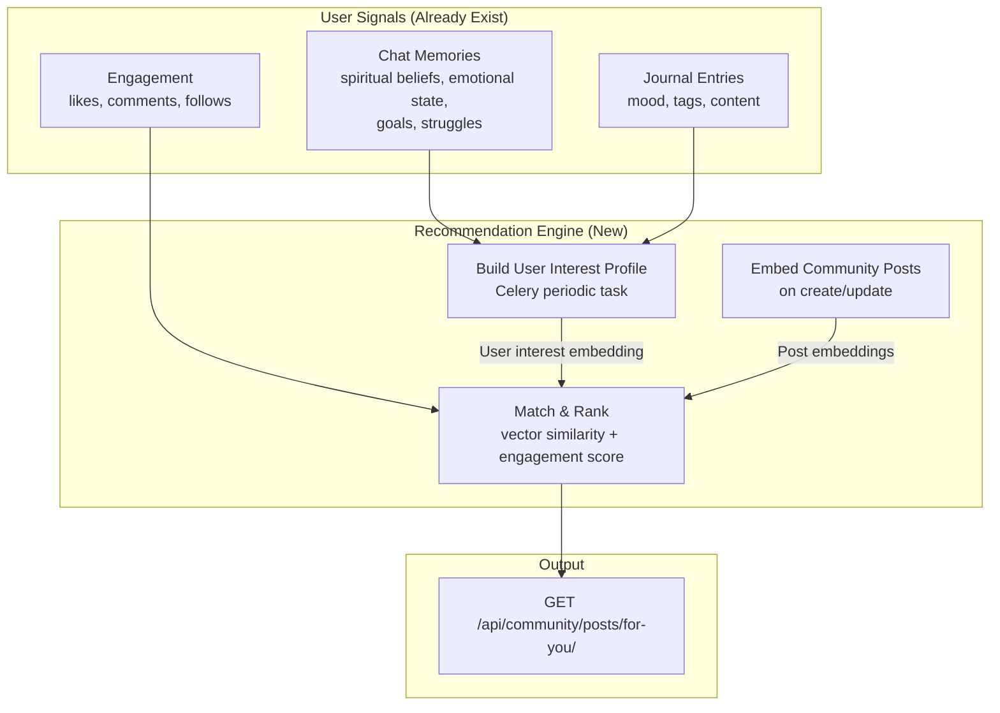

# AI-Powered Content Recommendation Using Chat Memory + Gemini

## Your Existing Data Goldmine

You already have an incredibly rich data pipeline that most apps would kill for:

| Data Source | Model | What It Captures |
|---|---|---|
| **Structured Memories** | [UserMemory](file:///home/akib/Desktop/Work/Soulciety-Backend/memory/models.py#7-46) | Categorized facts: identity, family, career, **spiritual beliefs**, **emotional struggles**, exercises, patterns |
| **Conversation Summaries** | [ConversationSummary](file:///home/akib/Desktop/Work/Soulciety-Backend/memory/models.py#48-78) | Key topics, **emotional state**, summary text per conversation |
| **Vector Embeddings** | ChromaDB via [vector_store.py](file:///home/akib/Desktop/Work/Soulciety-Backend/memory/vector_store.py) | Semantic embeddings of user memories using Gemini |
| **Journal Entries** | [JournalEntry](file:///home/akib/Desktop/Work/Soulciety-Backend/journal/models.py#8-32) | Mood, tags, content, AI-generated insights |
| **Engagement Signals** | [Like](file:///home/akib/Desktop/Work/Soulciety-Backend/community/models.py#43-50), [Comment](file:///home/akib/Desktop/Work/Soulciety-Backend/community/models.py#51-60), [Follow](file:///home/akib/Desktop/Work/Soulciety-Backend/community/models.py#61-68) | Who the user interacts with and what content resonates |
| **Viewing History** | `VideoTrack.views_count` | Video engagement (currently global, not per-user) |

---

## How It Would Work

### Step-by-Step Flow

1. **Build User Interest Profile** (Celery periodic task, e.g., every 6 hours)
   - Pull the user's [UserMemory](file:///home/akib/Desktop/Work/Soulciety-Backend/memory/models.py#7-46) records (spiritual beliefs, emotional landscape, goals)
   - Pull recent [ConversationSummary](file:///home/akib/Desktop/Work/Soulciety-Backend/memory/models.py#48-78) topics + emotional states
   - Pull recent [JournalEntry](file:///home/akib/Desktop/Work/Soulciety-Backend/journal/models.py#8-32) moods + tags
   - Feed all of this to Gemini → Generate a condensed "interest profile" text
   - Embed the profile using `models.embed_content()` → Store in a new ChromaDB collection

2. **Embed Community Posts** (on post creation)
   - When a new [CommunityPost](file:///home/akib/Desktop/Work/Soulciety-Backend/community/models.py#10-42) is created, embed its content
   - Store in a shared `community_posts` ChromaDB collection

3. **Serve "For You" Feed** (API endpoint)
   - Take the user's interest embedding → Query against posts collection
   - Blend with engagement signals (likes, comments, recency)
   - Return ranked posts

---

## Is This a Good Idea?

### ✅ Perks

| Perk | Why It Matters |
|---|---|
| **Deeply Personal** | No app in this space does this. You're matching **inner emotional/spiritual state** to content — not just "you liked X, here's more X." A user going through a healing journey sees healing-related posts. Someone working on manifestation sees vision posts. |
| **Uses Existing Infrastructure** | You already have Gemini, ChromaDB, Celery, and the memory extraction pipeline. This is an **extension**, not a rebuild. |
| **Increases Engagement** | Personalized feeds increase session time by 2-5x in social apps. Users feel "the app gets me" — critical for a spiritual growth community. |
| **Cold Start Solved** | Most recommendation systems struggle with new users who have no activity. Here, a single 5-minute chat with the AI mentor gives you enough memory data to start recommending. |
| **Moat / Competitive Advantage** | This becomes a feature no competitor can easily copy — the recommendation quality is tied to your AI chat depth. More conversations → better recommendations → more engagement → more conversations. A flywheel. |
| **Cross-App Synergy** | Journal moods can surface healing content. Chat struggles can surface relevant community stories. Everything feeds into everything else. |

### ⚠️ Cons / Risks

| Risk | Severity | Mitigation |
|---|---|---|
| **Privacy Concern** | 🔴 **HIGH** | Users share deeply personal things in chat (trauma, family issues, mental health). Using this to recommend content feels like surveillance if not disclosed properly. **Must have clear opt-in and transparency.** |
| **API Cost** | 🟡 **MEDIUM** | Embedding every post + rebuilding user profiles periodically = lots of Gemini API calls. With 1K users × every 6 hours = 4K embedding calls/day, plus post embeddings. Could cost $10-30/day at scale. |
| **Echo Chamber Effect** | 🟡 **MEDIUM** | If someone is in a dark emotional state, they only see posts about pain/struggle. This could reinforce negative spiraling instead of helping. **Must blend aspirational content to "pull up."** |
| **Stale Profiles** | 🟢 **LOW** | Users evolve. A profile built 3 months ago may not reflect today's state. Mitigated by using recency weighting and periodic rebuilds. |
| **Cold Start for Posts** | 🟢 **LOW** | New posts have no engagement data. Mitigated by using content similarity as the primary signal, engagement as secondary. |
| **Infrastructure Complexity** | 🟡 **MEDIUM** | Adds a new Celery beat task, new ChromaDB collections, new API endpoint. Manageable but increases operational surface area. |
| **Accuracy / Relevance** | 🟡 **MEDIUM** | Embedding-based matching can surface tangentially related content. A post about "letting go of a toxic job" might match a user whose memory says "career struggles" even if the contexts are very different. |

---

## The Privacy Question — This Is the Big One

> [!CAUTION]
> **Your chat memory contains deeply sensitive information** — mental health states, family trauma, relationship details, financial struggles. Using this data to determine what community posts a user sees requires **explicit, informed consent.**

### What You Need Before Building This:
1. **Opt-in toggle**: "Use my conversations to personalize my feed" — OFF by default
2. **Transparency**: "Your feed is personalized based on topics from your chat sessions" — visible in the feed
3. **Clear data boundaries**: Never expose *why* something was recommended (i.e., don't say "Because you mentioned your divorce")
4. **Escape hatch**: User can always switch to "Latest" or "Following" feed to bypass recommendations

---

## My Honest Assessment

> [!IMPORTANT]
> **Yes, it's a great idea — but only with privacy guardrails.** The technical foundation is uniquely strong here. Most apps need years of click data to build good recommendations. You already have *stated intentions, emotional context, and semantic understanding* from Day 1 via chat memories. That's rare and powerful.

The **right implementation order** would be:

1. Start with **engagement-weighted scoring** (simple, no privacy concern, ship in 1 day)
2. Add **journal mood + tags matching** (low privacy risk — users explicitly chose those moods)
3. Then add **chat memory matching** (high impact, high privacy — needs opt-in UI)

This way you ship value immediately while building toward the full AI-powered system.

---

## Estimated Effort

| Phase | Scope | Time |
|---|---|---|
| Phase 1: Engagement-weighted feed | New endpoint, score by `likes × 2 + comments × 3 + recency_bonus` | ~3-4 hours |
| Phase 2: Post embeddings | Embed posts in ChromaDB on create, similarity search | ~4-5 hours |
| Phase 3: User interest profiles | Celery task to build profile from memories + journals, match to posts | ~6-8 hours |
| Phase 4: Privacy controls | Opt-in model field, API toggle, feed modes | ~2-3 hours |
