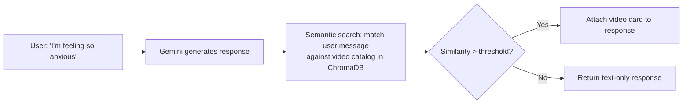
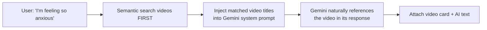

# In-Chat Video Recommendation — Analysis

## The Concept

> While a user chats with Soulciety AI about anxiety, the AI naturally suggests:
> *"I hear you. That heaviness is real. There's actually a 5-minute guided breathing session in the app that might help right now — want me to share it?"*

The video card appears **inline in the chat**, clickable, taking them directly to the video player.

---

## How Your Current Chat Flow Works

```
User sends message → save to DB → Celery task: generate_ai_response()
    ↓
    Build memory context → Build message history → Call Gemini → Save AI response
    ↓
    Return { ai_message_id, content }
```

**The injection point is clear**: right after Gemini generates the AI response, or even better — tell Gemini about the available videos so it can naturally weave them in.

---

## Two Approaches

### Approach A: Post-Processing Injection (Simpler)



**How it works:**
1. After Gemini generates the text response, take the user's message
2. Embed it → Query the `spiritual_videos` ChromaDB collection
3. If a video matches above a threshold → Attach it to the response JSON
4. Frontend renders a video card below the AI's text message

**Response format changes:**
```json
// Before (current)
{
  "ai_message_id": 42,
  "content": "I hear you. That anxiety is trying to tell you something..."
}

// After (with video recommendation)
{
  "ai_message_id": 42,
  "content": "I hear you. That anxiety is trying to tell you something...",
  "recommended_video": {
    "id": 7,
    "title": "5-Minute Anxiety Relief Breathing",
    "thumbnail_url": "https://res.cloudinary.com/...",
    "duration_formatted": "05:23",
    "relevance_reason": "breathing & anxiety"
  }
}
```

### Approach B: Gemini-Aware (More Natural)



**How it works:**
1. **Before** calling Gemini, search ChromaDB for videos matching the user's message
2. If matches found, inject into system prompt: `"Available video the user might benefit from: '5-Minute Anxiety Relief Breathing' (05:23). If contextually appropriate, naturally suggest they check it out. Don't force it."`
3. Gemini weaves the suggestion naturally: *"You know what might actually help right now? There's a 5-minute breathing session in the app — sometimes just pausing and breathing shifts everything."*
4. Attach the video card to the response

---

## Example Conversation Flows

### 😟 Anxiety Scenario
```
User: "I can't stop overthinking. My mind won't shut off."

AI: "That racing mind is exhausting, I know. Here's the thing —
your thoughts aren't facts, they're just loud right now.
Try this: take 3 slow breaths, and with each exhale,
imagine those thoughts dissolving like smoke.

There's also a short guided meditation in the app that's
perfect for exactly this — want to give it a try?"

[🎥 Quieting the Overthinking Mind — 07:12] ← tappable video card
```

### 💔 Heartbreak Scenario
```
User: "I just found out my ex moved on. I feel so worthless."

AI: "That sting is real. But their moving on says nothing
about your worth — absolutely nothing. You're not behind.
You're healing at your own pace, and that takes courage.

This might help right now:"

[🎥 Releasing Attachment & Finding Inner Peace — 10:45]
```

### 🌅 Manifestation Scenario
```
User: "I want to start visualizing but I don't know how"

AI: "Love that you're ready for this! Visualization is simpler
than most people make it. Start with just 2 minutes before
sleep — picture one specific scene of your desired reality.
Feel it as real. That's it.

Actually, we have a guided session that walks you through
exactly this:"

[🎥 Beginner's Guide to SATS Visualization — 08:30]
```

---

## Why This Is Better Than a "For You" Feed

| "For You" Feed | In-Chat Recommendation |
|---|---|
| User has to go look for it | Video comes to them at the **perfect moment** |
| Generic relevance | Contextually precise — matched to their **current emotional state** |
| Feels algorithmic | Feels like a caring mentor sharing a resource |
| Easy to scroll past | Part of an intimate 1:1 conversation — high trust |
| Low conversion (~5-10% click rate) | **High conversion (30-50%+)** — they're already engaged and emotionally open |

---

## Pros & Cons

### ✅ Pros

| Pro | Why |
|---|---|
| **Perfect timing** | Videos are suggested when the user is emotionally receptive, not when they're browsing |
| **Zero privacy risk** | You're matching the **current message** against video metadata — not using stored memories at all |
| **Increases video views** | Most powerful discovery channel — beats any feed algorithm |
| **Deepens AI value** | The AI feels more helpful — it's not just talking, it's giving actionable resources |
| **Simple to build** | ~100-150 lines of code. Reuses your existing ChromaDB + Gemini patterns |
| **No opt-in needed** | No sensitive data is used — just semantic matching of message text to video titles/descriptions |

### ⚠️ Cons

| Con | Severity | Mitigation |
|---|---|---|
| **Annoying if overdone** | 🟡 Medium | Rate limit: max 1 video per conversation per session. Never suggest on the first 2 messages |
| **Latency** | 🟡 Medium | ChromaDB search adds ~50-200ms. Run it **in parallel** with Gemini call, not after |
| **Irrelevant matches** | 🟢 Low | Set a high similarity threshold (e.g., distance < 0.8). Better to suggest nothing than something wrong |
| **Small catalog** | 🟢 Low | If you only have 20 videos, matches will sometimes be a stretch. Grows naturally as you add content |
| **Adds ~50ms to response** | 🟢 Low | Negligible since Gemini already takes 1-3 seconds |

---

## What Needs to Change

### 1. One-time: Embed all videos in ChromaDB
```python
# New function in spiritual/video_embeddings.py
# Embed each video's "title + description + category names"
# Store in collection: "spiritual_videos_catalog"
```

### 2. Auto-embed on new video upload
```python
# Modify spiritual/models.py post_save signal
# After notify_new_video, also embed the video
```

### 3. Search function
```python
# New function: find_relevant_video(user_message_text) → VideoTrack or None
# Query ChromaDB "spiritual_videos_catalog" collection
# Return best match if distance < threshold, else None
```

### 4. Inject into chat response
```python
# Modify chat/tasks.py generate_ai_response()
# After Gemini response, call find_relevant_video(user_message_content)
# If match found, add to return payload
```

### 5. Response format update
```python
# Modify return value:
# { "ai_message_id": ..., "content": ..., "recommended_video": {...} | null }
```

---

## Estimated Effort

| Step | Time |
|---|---|
| Video embedding utility + one-time embed script | 1-2 hrs |
| `post_save` signal for auto-embedding new videos | 30 min |
| `find_relevant_video()` search function | 1 hr |
| Modify [generate_ai_response](file:///home/akib/Desktop/Work/Soulciety-Backend/chat/tasks.py#60-246) in [chat/tasks.py](file:///home/akib/Desktop/Work/Soulciety-Backend/chat/tasks.py) | 1 hr |
| Rate limiting logic (don't over-suggest) | 30 min |
| **Total** | **~4-5 hours** |

> [!IMPORTANT]
> **Approach B (Gemini-aware) is recommended.** It adds maybe 30 minutes more work but the result is dramatically more natural — the AI weaves the video suggestion into its response instead of it being a bolted-on card. Users feel like the AI is genuinely helping, not selling.
