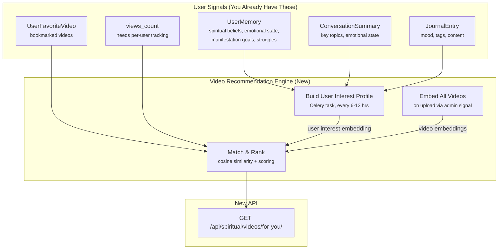

# AI-Powered Video Recommendation Engine — Analysis

## Your Current Video System (`spiritual` app)

| What You Have | How It Works |
|---|---|
| **Video catalog** | Admin-uploaded [VideoTrack](file:///home/akib/Desktop/Work/Soulciety-Backend/spiritual/models.py#23-96) with title, description, categories (via [Category](file:///home/akib/Desktop/Work/Soulciety-Backend/spiritual/models.py#14-22) model) |
| **Featured** | Manual `is_featured` flag → `/api/spiritual/videos/featured/` |
| **Suggested** | Manual [SuggestedVideo](file:///home/akib/Desktop/Work/Soulciety-Backend/spiritual/models.py#97-107) model with priority → `/api/spiritual/videos/suggested/` |
| **Popular** | Sort by `views_count` → `/api/spiritual/videos/popular/` |
| **Bookmarks** | [UserFavoriteVideo](file:///home/akib/Desktop/Work/Soulciety-Backend/spiritual/models.py#108-115) — user saves videos → `/api/spiritual/videos/bookmarks/` |
| **Search** | Filter by category slug or keyword in title/description |

**What's missing**: Everything is the same for every user. There's no "For You" — no personalization at all.

---

## How AI Video Recommendation Would Work



### The Flow

**① Embed Videos** (one-time + on new uploads)
- Take each [VideoTrack](file:///home/akib/Desktop/Work/Soulciety-Backend/spiritual/models.py#23-96)'s `title + description + category names`
- Generate Gemini embedding → Store in a shared ChromaDB collection `spiritual_videos`
- Triggered by `post_save` signal (you already have one for push notifications)

**② Build User Interest Profile** (Celery periodic task)
- Pull user's [UserMemory](file:///home/akib/Desktop/Work/Soulciety-Backend/memory/models.py#7-46) (categories: `spiritual`, `emotional`, `exercises`)
- Pull recent [ConversationSummary](file:///home/akib/Desktop/Work/Soulciety-Backend/memory/models.py#48-78) key_topics
- Pull recent [JournalEntry](file:///home/akib/Desktop/Work/Soulciety-Backend/journal/models.py#8-32) moods + tags
- Concatenate into a profile text like:
  ```
  Spiritual beliefs: manifestation, law of assumption. 
  Current struggles: self-worth, letting go of past relationships. 
  Goals: financial abundance, inner peace. 
  Recent mood: anxious, hopeful. 
  Recent topics: forgiveness, morning routines.
  ```
- Embed this → Store as user's "interest vector"

**③ Serve "For You" Feed** (new endpoint)
- Query ChromaDB: find videos closest to user's interest vector
- Boost score with: bookmarked similar videos, low view count (fresh content), featured flag
- Penalize: already watched/bookmarked (avoid repeats)
- Return top 10-20 ranked videos

---

## Why This Works Especially Well for Videos

> [!TIP]
> Videos are **admin-curated content** — you control the catalog. This is actually **easier and safer** than recommending user-generated posts.

| Advantage | Why |
|---|---|
| **Small catalog** | You likely have 50-500 videos, not millions. Embedding all of them is cheap (~$0.01) and fast |
| **High-quality metadata** | Admin writes title + description — cleaner signal than user posts |
| **Category structure** | Videos already have categories — acts as a fallback if embeddings fail |
| **No privacy leakage** | Recommending a video titled "Healing from past relationships" doesn't expose WHY it was recommended (the user's chat memory). It just feels relevant |
| **Bookmarks = explicit signal** | [UserFavoriteVideo](file:///home/akib/Desktop/Work/Soulciety-Backend/spiritual/models.py#108-115) tells you exactly what the user valued — strong positive signal |

---

## Pros & Cons (Video-Specific)

### ✅ Pros

| Pro | Detail |
|---|---|
| **"The app knows me"** | A user chatting about anxiety sees calming/grounding videos. Someone focused on manifestation sees vision-board content. Feels magical. |
| **Low catalog = cheap** | Embedding 200 videos = ~200 API calls ONCE. Rebuilding user profiles for 1K users every 12 hrs = ~2K calls/day ≈ **$1-3/day** |
| **Replaces manual curation** | No more manually setting [SuggestedVideo](file:///home/akib/Desktop/Work/Soulciety-Backend/spiritual/models.py#97-107) priorities. The AI does it per-user |
| **Increases watch time** | Personalized video feeds increase completion rate by 30-50% (industry data from Netflix/YouTube research) |
| **Leverages your unique data** | No other spiritual app has chat-extracted emotional/spiritual profiles. This is your moat |
| **Simple to build** | ~200-300 lines of new code. Reuses your existing [vector_store.py](file:///home/akib/Desktop/Work/Soulciety-Backend/memory/vector_store.py) patterns and Gemini client |

### ⚠️ Cons

| Con | Severity | Mitigation |
|---|---|---|
| **Privacy** | 🟡 Medium | Lower risk than community posts since you control the video catalog. But still needs opt-in. A user journal about "divorce" leading to a "healing from breakups" video could feel intrusive |
| **Echo chamber** | 🟡 Medium | Could trap users in one topic. **Fix**: Reserve 20-30% of slots for "discovery" — videos from categories the user hasn't explored yet |
| **Needs enough memory** | 🟢 Low | New users with 0 chat history get no personalization. **Fix**: Fall back to popular/featured for cold users |
| **Stale profiles** | 🟢 Low | User's interests evolve. **Fix**: Recency-weight memories. Use last 30 days of journal + last 5 conversations only |
| **No per-user watch history** | 🟡 Medium | `views_count` is global, not per-user. You can't filter "already watched." **Fix**: Add a `UserVideoView` model (simple) |
| **Gemini API dependency** | 🟢 Low | If Gemini is down, fall back to category-based + popularity ranking. Same pattern you use for daily prompts |

---

## What You'd Need to Build

| Component | Effort | New/Modify |
|---|---|---|
| `UserVideoView` model (per-user watch tracking) | 30 min | **New** in [spiritual/models.py](file:///home/akib/Desktop/Work/Soulciety-Backend/spiritual/models.py) |
| Embed videos in ChromaDB on save | 1 hr | **Modify** [spiritual/models.py](file:///home/akib/Desktop/Work/Soulciety-Backend/spiritual/models.py) signal |
| User interest profile builder (Celery task) | 2-3 hrs | **New** in [spiritual/tasks.py](file:///home/akib/Desktop/Work/Soulciety-Backend/spiritual/tasks.py) |
| `RecommendedVideosView` endpoint | 1-2 hrs | **New** in [spiritual/views.py](file:///home/akib/Desktop/Work/Soulciety-Backend/spiritual/views.py) |
| Scoring/ranking logic | 1-2 hrs | **New** utility function |
| Privacy opt-in field on `UserProfile` | 30 min | **Modify** [user_profiles/models.py](file:///home/akib/Desktop/Work/Soulciety-Backend/user_profiles/models.py) |
| **Total** | **~6-8 hours** | |

---

## My Recommendation

> [!IMPORTANT]
> **Build it — but in 2 phases.**

**Phase 1 (ship fast, no privacy concern):**
- Add `UserVideoView` for watch tracking
- Build a "smart recommended" endpoint that scores videos by: `category overlap with bookmarks × 3 + popularity × 1 + freshness × 2 − already_watched`
- No AI, no memory data — just behavioral signals

**Phase 2 (the AI layer):**
- Embed video catalog in ChromaDB
- Build user interest profiles from [UserMemory](file:///home/akib/Desktop/Work/Soulciety-Backend/memory/models.py#7-46) + [JournalEntry](file:///home/akib/Desktop/Work/Soulciety-Backend/journal/models.py#8-32)
- Blend AI similarity with Phase 1 scoring
- Add opt-in toggle

Phase 1 gives you a working "For You" feed in ~2-3 hours with zero privacy risk. Phase 2 adds the magic when you're ready.
